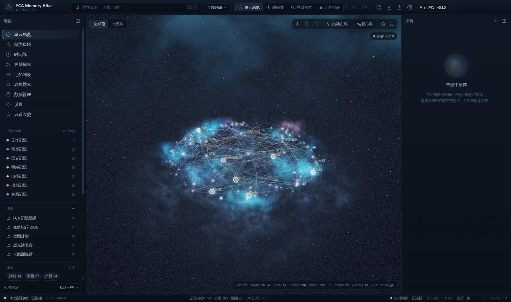
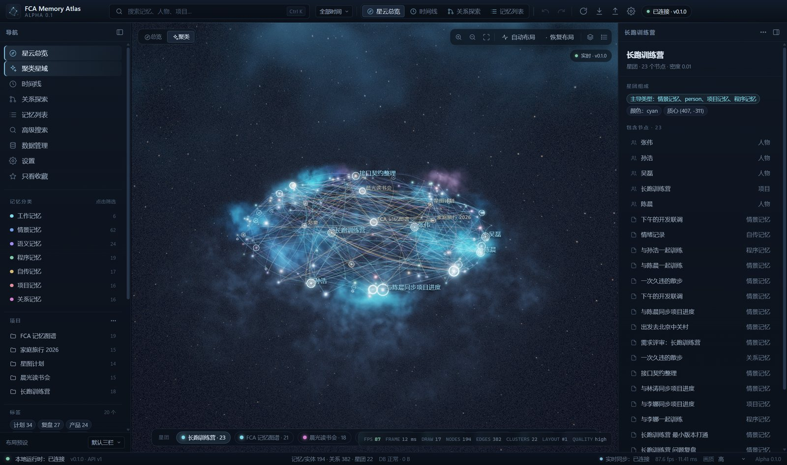
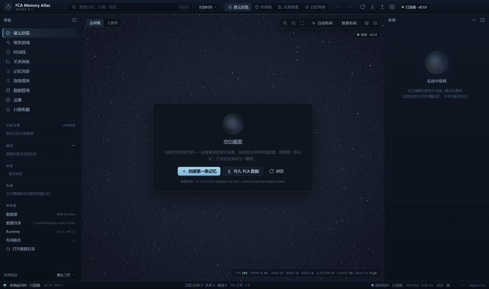
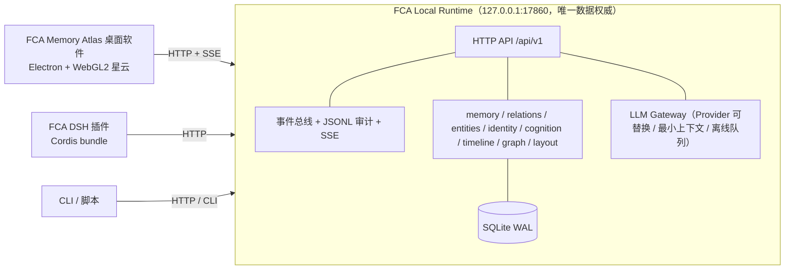

# FCA Memory Atlas

**本地优先的认知记忆基础设施**：一个 Windows 桌面软件（星云式记忆可视化）+ 一个本地认知 Runtime + 一个 DeepSeek Harness(DSH) 正式插件。记忆、关系、布局、身份和认知状态全部保存在你的本机，LLM 只是可替换的 API 能力，不依赖任何云端记忆库。

> Local-first cognitive memory infrastructure for Windows: a nebula-style memory atlas desktop app, a local HTTP Runtime (SQLite, `127.0.0.1` only), and an official DeepSeek Harness plugin. All memories stay on your machine.



| 星云总览 | 聚类星域 | 全新空库（无假数据） |
|---|---|---|
|  |  |  |

真实运行录屏：[docs/media/fca-atlas-nebula.webm](docs/media/fca-atlas-nebula.webm)（VP9，10s，真实 renderer + 真实 Runtime 数据）。

## 核心特性

- **星云式记忆可视化**：WebGL2 体积星云（数据驱动的气体云、尘埃暗带、深度层次、恒星核、关系光丝），不是普通节点图；空库只显示真实深空背景，不伪造节点。支持 `ultra/high/medium/low/off` 性能档位，关闭特效仍可完整交互。
- **完整记忆编辑**：新建/编辑/软删除/回收站/合并/拆分/版本历史/diff/冲突检测/撤销重做；关系是独立数据实体（可增删改，不级联删除两端）。
- **本地认知 Runtime**：`127.0.0.1:17860`，SQLite WAL，Bearer token，统一错误码 + trace id，SSE 实时推送（断线用 `Last-Event-ID` 补发），FTS/中文 bigram 全文检索 + 本地语义检索，备份/恢复/导入/导出/迁移/健康检查。
- **DSH 正式插件（Cordis bundle）**：给 Agent 注册 `fca_memory_search / fca_memory_store / fca_memory_get / fca_status`；**完全自动记忆**（`autoMemory`）——你在任意 DSH 会话里输入的每条真实用户消息会自动写成一条真实 FCA 记忆并实时出现在桌面星图；事件审计采集、可选系统提示注入、Runtime 自动拉起。
- **本地优先与安全**：默认仅回环监听；LLM Provider 可替换（DeepSeek / OpenAI-compatible / 自定义），API Key 本机 AES-256-GCM 加密、日志/界面掩码；离线时本地浏览与编辑不降级，LLM 请求入队而不是伪装成功。
- **可追溯**：每条记忆/关系都有来源、时间、版本、操作主体（user/agent/system/plugin）与 JSONL 事件审计镜像。

## 系统要求

| 项 | 要求 |
|---|---|
| 操作系统 | Windows 10/11 x64 |
| 运行时 | 安装包已自带 Node 24（用源码运行需 Node ≥ 24） |
| 磁盘 | 安装 ≈ 360 MB，数据目录按需增长 |
| GPU（可选） | NVIDIA GPU 可用 WebGL 加速；无 GPU 时软件渲染仍可用 |
| DSH 插件 | DSH NEXT（`2.0.22-next` 实测）或兼容的 Cordis Host |

## 快速开始

### A. 安装包（推荐，普通用户）

1. 从 [Releases](https://github.com/hutao48/fca-memory-atlas/releases/latest) 下载 `FCA-Memory-Atlas-Setup-*.exe`（或在源码中运行 `node installer/build.js` 自行构建）；也可直接双击仓库内构建产物（若有）。
2. **从 Windows 文件资源管理器双击**安装（per-user，无需管理员）。不要从自动化沙箱/终端以受限权限启动，否则写注册表/快捷方式会被拒绝。
3. 首次启动 → 首次启动向导：选择数据目录（默认 `%LOCALAPPDATA%\FCA-Memory-Atlas`）与端口（默认 `17860`）→ 初始化空库。
4. 开始创建记忆即可；数据目录可随时在设置中更换。

### B. 源码运行（开发者）

```powershell
git clone https://github.com/hutao48/fca-memory-atlas.git
cd fca-memory-atlas
node --version   # 需要 >= 24
node runtime/bin/fca-runtime.js init
node runtime/bin/fca-runtime.js serve          # 另开终端可保持运行
node scripts/start-desktop.js                  # 开发模式启动桌面 UI
```

无系统 Node 时，安装 DSH 后可用其自带 Node，或使用仓库 `tools/node.cmd`（本机工具链封装）。

### C. 安装 DSH 正式插件

通过 DSH 的 plugin manager 安装（**不要手改 profile 文件**）：

```text
plugin_manager action=install_bundle target=<repo>/dsh_plugin
```

然后让 Agent 调用 `fca_status` 确认 `runtime.reachable=true`、`api_version="1"`；`fca_memory_store` 写入一条记忆验证真实链路。插件默认开启 `autoMemory: user-messages`，之后的真实用户消息会自动进入记忆库。详见 [dsh_plugin/README.md](dsh_plugin/README.md)。

### D. AI Agent 一键部署提示词

仓库自带一段可交给 **DeepSeek 等 Agent 自主执行**的安装部署提示词：[`deploy/DEEPSEEK_AGENT_PROMPT.md`](deploy/DEEPSEEK_AGENT_PROMPT.md)（配套 `deploy/install-source.ps1` 引导脚本）。把该提示词和仓库地址交给 Agent，它会按步骤检查环境、安装/构建、初始化数据库、启动 Runtime、安装 DSH 插件并逐项验收。

## 架构



- 三个产品共享**同一个** Runtime 与**同一套**数据；关闭任一界面都不影响数据完整性。
- 记忆读写不依赖任何 LLM；LLM 断开时本地功能不降级。
- 完整性契约见 [`docs/PUBLIC_INTERFACE_FREEZE.md`](docs/PUBLIC_INTERFACE_FREEZE.md)，API 文档见 [`docs/API.md`](docs/API.md)。

## 验证（真实命令）

```powershell
# Runtime 端到端冒烟（隔离数据目录，23 项检查）
node scripts/verify.js --fca-home=.cache/verify --port=17880

# 自动化测试（unit / integration / e2e / security / performance / install）
node scripts/run-tests.js --all

# 插件单元测试
node --test "tests/unit/plugin/*.test.js"
```

## 目录结构

```
runtime/      FCA Local Runtime（Node 24 + node:sqlite，零第三方运行时依赖）
desktop/      Electron 桌面软件（main 主进程 + renderer ESM + WebGL2 星云）
dsh_plugin/   DSH 正式 Cordis 插件（bundle：cordis.patch.yml + main.js + src/）
installer/    NSIS 安装包构建（build.js / installer.nsi）
deploy/       AI Agent 部署提示词与源码引导脚本
docs/         架构、接口冻结、API、用户手册、测试报告、已知问题、ADR
tests/        unit / integration / e2e / security / performance / install
scripts/      verify / run-tests / capture / record / fetch-* 等开发脚本
config/       运行配置样例；data_template/ 全新空库说明
```

## 已知限制

详见 [`docs/KNOWN_ISSUES.md`](docs/KNOWN_ISSUES.md)。摘要：仅 Windows x64；Alpha 阶段无代码签名（SmartScreen 可能提示）；10000 节点布局/图数据为秒级同步计算（可交互规模 ≤1000 节点）；语义检索为本地确定性哈希向量（非神经网络）；自动记忆保存消息原文级别记录并受每时限流；本机回环场景下的安全风险项（ZIP 无解压上限、导入导出路径未限制、无限流）已在文档记录。

## 文档

| 文档 | 内容 |
|---|---|
| [docs/USER_MANUAL.md](docs/USER_MANUAL.md) | 用户手册：安装/首启向导/星图/编辑/关系/时间线/搜索/数据管理/LLM/排错 |
| [docs/ARCHITECTURE.md](docs/ARCHITECTURE.md) | 架构与 ADR |
| [docs/PUBLIC_INTERFACE_FREEZE.md](docs/PUBLIC_INTERFACE_FREEZE.md) | 冻结的数据模型 / API / 事件 / 错误码 / 渲染契约 |
| [docs/API.md](docs/API.md) | HTTP API 文档 |
| [docs/TEST_REPORT.md](docs/TEST_REPORT.md) | 测试与性能报告（真实数据） |
| [docs/PLUGIN_INTEGRATION_TEST.md](docs/PLUGIN_INTEGRATION_TEST.md) | DSH 插件真实安装与端到端验证（含 autoMemory） |
| [docs/KNOWN_ISSUES.md](docs/KNOWN_ISSUES.md) | 已知问题与边界 |
| [CHANGELOG.md](CHANGELOG.md) | 变更日志 |

## 许可证

[MIT](LICENSE)。第三方组件（Electron / Chromium / Node.js 等）遵循其各自许可证；安装包内保留对应许可证文本。
