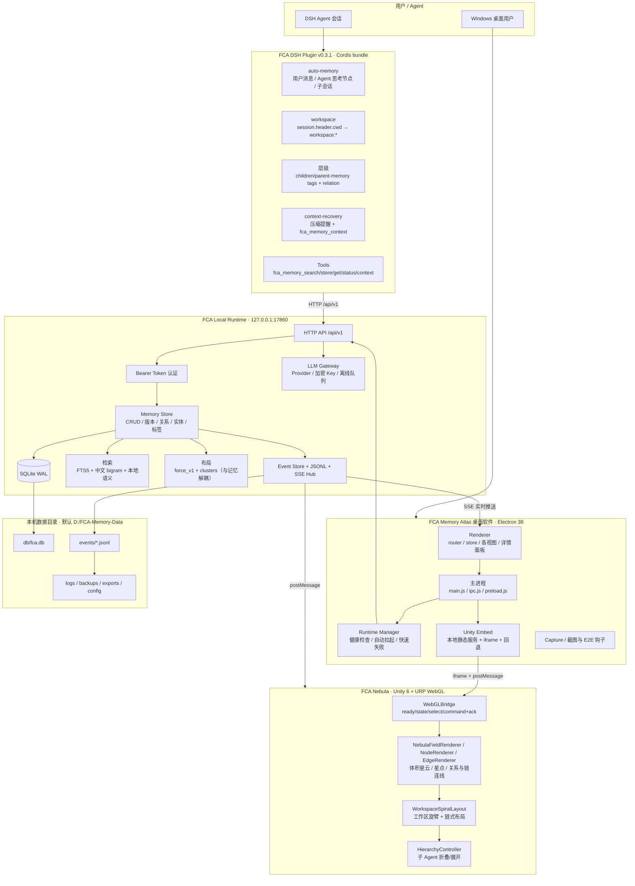
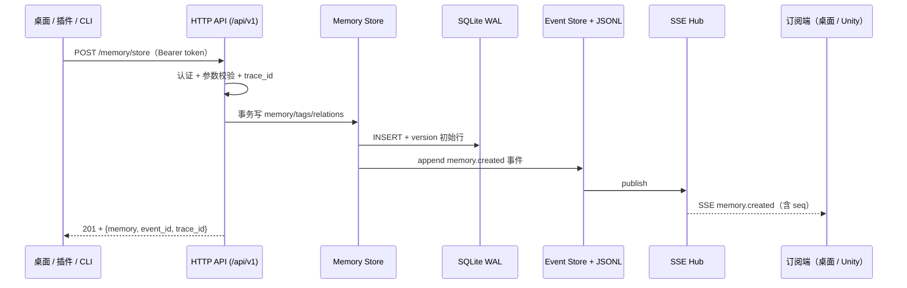
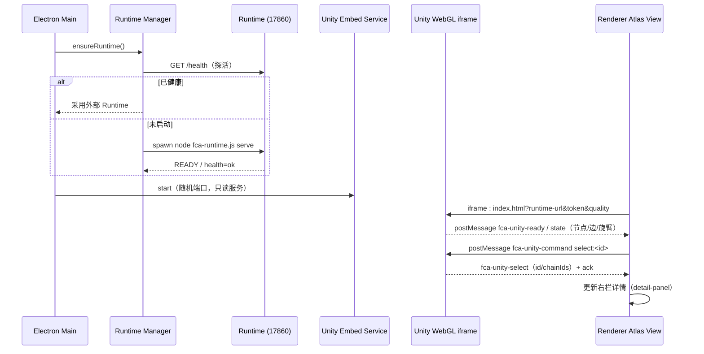
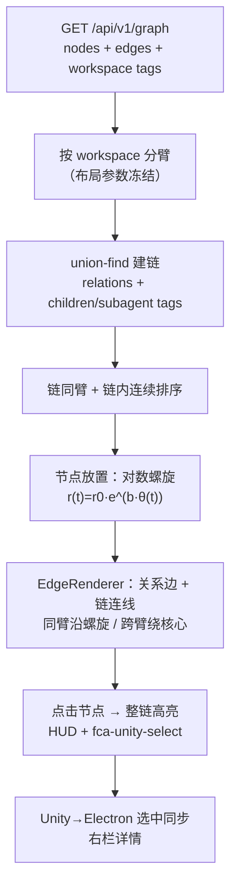
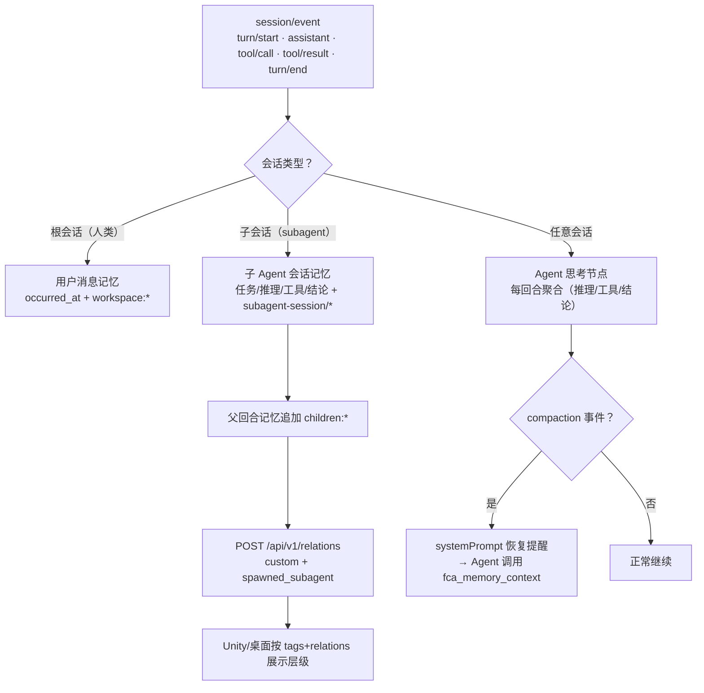
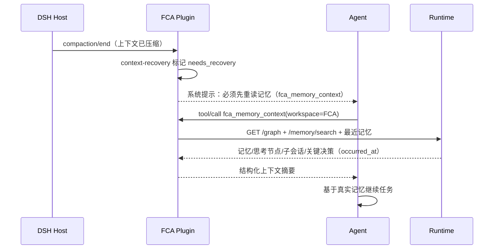

# FCA Memory Atlas — v0.4.0

> **许可（v0.4.0 起 / License）**：源码可见，**禁止商用、禁止二次修改后分发**；仅允许个人非商业查看/学习/本机运行官方版本，以及为自己的个人使用在本机修改（修改版不得以任何形式分发）。详见 [LICENSE](LICENSE)。v0.4.0 之前的版本继续适用其发布时随附的 MIT 许可。

FCA（Fish Cognitive Architecture）的本地认知基础设施实现，交付四个可运行部分：

| 产品 | 说明 | 目录 / 交付物 |
|---|---|---|
| **FCA Memory Atlas** | 可安装的 Windows x64 桌面软件（Electron 38 + **Unity 6/URP WebGL 星云**，内置 WebGL 回退） | `desktop/`；安装包 `artifacts/installer/FCA-Memory-Atlas-Setup-0.4.0-x64.exe` |
| **FCA Local Runtime** | 本地认知服务（127.0.0.1:17860，SQLite WAL，零第三方运行时依赖） | `runtime/`；随安装包分发（含随包 Node 24） |
| **FCA DSH Plugin** | 正式 DSH Cordis 插件 v0.3.1（安装到 DSH profile，连接同一 Runtime；自动记忆 + 子 Agent 层级 + 上下文恢复） | `dsh_plugin/`；产物 `artifacts/plugin/dsh-plugin-fca-memory-0.3.1.tgz` |
| **FCA Nebula（Unity WebGL）** | Unity 6（6000.0.23f1）+ URP 17.0.3 WebGL 星云渲染器（工作区旋臂 + 记忆链 + Agent 思考节点），**内嵌 Electron 界面**（本地静态服务 + iframe） | `unity/FCANebula/`；随安装包分发到 `<安装目录>\unity\FCANebulaWebGL\`，构建产物 `artifacts/unity/FCANebulaWebGL/` |

四者共享同一个 FCA Local Runtime 和同一套数据；任一 UI 关闭不影响数据完整性。LLM 通过 API Gateway 调用，模型可替换；本地记忆的读写不依赖任何 LLM。

**v0.4.0 新功能**：**Unity 6 + URP WebGL 渲染升级**（HDR/ACES/Bloom Volume 后处理、体积星云/节点/光丝视觉提升）；**关联记忆节点可见连线、同一记忆链同一旋臂、单击节点高亮整条记忆链**；许可证改为「源码可见（非商用 · 禁止二次修改分发）」。其余功能同 v0.3.0。

**v0.3.0 新功能**：子 Agent 记忆层级展开（Unity 点击父节点展开子会话）、Unity↔桌面双向选中同步、插件 0.3.1（精确时间戳/子 Agent 全量采集/父子关系/上下文恢复工具 `fca_memory_context`）、桌面 UI 修复（关系详情/左右栏常驻开关/层级面板）、Unity 旋臂-节点-连线几何修复。

**v0.2.1 稳定性修复**：修复「强杀桌面 app 后 Runtime 子进程 stdout/stderr 管道断开 → EPIPE uncaughtException 死循环 → `/health` 超时 / app 启动 PORT_IN_USE」的 P0 问题（Runtime 进程级 EPIPE 处理 + 控制台日志永久降级为仅文件日志；桌面端 Runtime 启动失败快速失败不再空等 30s）。回归测试 `runtime/test/logger-epipe.test.js` 3/3、真实复现脚本 PASS。

**v0.2.0 重点**：星云渲染迁移到 Unity WebGL 并内嵌 Electron 界面（默认引擎，失败自动回退内置 WebGL 星云）；同一工作区的记忆自动归到星云的一条旋臂（`workspace:<label>` 标签驱动，旧记忆无需迁移）；DSH 插件把每个 Agent 回合聚合为一条 **Agent 思考节点**记忆（推理/工具/结论，脱敏后入库）；插件 v0.2.1 过滤子会话 user-role 消息并清理历史噪声。详见 `CHANGELOG.md` 与 `docs/UNITY_NEBULA.md`。

## 可视化项目结构

### 组件架构图



### 目录结构（带职责说明）

```text
FCA-Memory-Atlas/
├─ desktop/                     Windows 桌面软件（Electron 38）
│  ├─ main/                     主进程：窗口生命周期、IPC、Runtime 管理、Unity 内嵌服务
│  │  ├─ main.js                应用入口：窗口、单实例、视觉引擎、E2E 截图钩子
│  │  ├─ runtime-manager.js     Runtime 健康检查、自动拉起、退出监控、快速失败
│  │  ├─ unity-embed.js         Unity WebGL 本地静态服务（127.0.0.1 随机端口）+ iframe URL
│  │  ├─ unity-viewer.js        旧 standalone 方案（FCA_UNITY_STANDALONE=1 开发开关）
│  │  ├─ net-client.js          Runtime HTTP 客户端（主进程注入 Bearer token）
│  │  ├─ ipc.js / preload.js    安全 IPC + contextBridge 暴露 window.fca
│  │  ├─ paths.js / settings.js 数据目录/版本/设置持久化（BOM 容错）
│  │  └─ capture.js             截图/E2E 验收入口
│  └─ renderer/                 渲染进程（原生 ESM，无构建步骤）
│     ├─ app.js                 壳层：store / router / 视图装配 / 快捷键 / 错误边界
│     ├─ views/                 atlas / list / editor / relations / timeline / search / data / settings / onboarding
│     └─ lib/                   api / detail-panel / hierarchy / unity-selection / router / ui / commands / format
├─ runtime/                     FCA Local Runtime（Node 24，node:sqlite，零第三方运行时依赖）
│  ├─ bin/fca-runtime.js        CLI：init / serve / status / stop / backup / restore / export / import / logs / seed / migrate
│  └─ src/
│     ├─ runtime.js             进程装配、HTTP 启动、优雅关闭、pid/lock、EPIPE 防护
│     ├─ api/routes/            health / state / memory / relations / entities / tags / events / graph / layout / timeline / backup / exchange / llm / db / system / shutdown
│     ├─ memory/                store（事务+版本历史）、search（FTS5/中文 bigram）、semantic、filters、validate、present
│     ├─ events/               事件表 + JSONL 审计镜像 + SSE Hub（Last-Event-ID 补发）
│     ├─ layout/               force_v1 确定性布局 + 聚类，独立写入 layout_nodes（不影响记忆）
│     ├─ persistence/          SQLite 连接、WAL、迁移
│     ├─ llm/                  Provider CRUD、AES-256-GCM Key Vault、最小上下文、离线 202 队列与重试
│     ├─ backup/ exchange/     备份/恢复、导出/导入（zip + sha256）
│     ├─ graph/ identity/ cognition/ catalog/ services.js  graph 视图、身份/认知状态、实体/关系/标签、服务装配
│     └─ logging/ security/    JSONL 结构化日志（64MB 轮转）、日志脱敏、Bearer token
├─ dsh_plugin/                  DSH Cordis 插件 v0.3.1（bundle：cordis.patch.yml + main.js + src/）
│  ├─ main.js                   Cordis 入口：注册工具、监听 session/event、启动 bridge
│  └─ src/
│     ├─ auto-memory.js         自动记忆编排（用户消息/Agent思考节点/子会话/去重/限流/队列）
│     ├─ agent-nodes.js         回合聚合（reasoning / tool call / tool result / conclusion）
│     ├─ workspace.js           session.header.cwd → workspace:<label>；project 实体
│     ├─ session-scope.js       根会话 vs 子会话（parentSession/delegationDepth/origin）
│     ├─ context-recovery.js    systemPrompt.section + compaction 事件 + fca_memory_context
│     ├─ tools.js               fca_memory_search/store/get/status/context
│     ├─ capture.js / bridge.js / client.js / launcher.js / config.js / logger.js / time.js / prompt-context.js / commands.js
├─ unity/FCANebula/             Unity 6（6000.0.23f1）+ URP 17.0.3 工程
│  ├─ Assets/Scripts/
│  │  ├─ Data/                  FcaApiClient（/graph、/state、/memory 轮询）、Graph DTO
│  │  ├─ Layout/                WorkspaceSpiralLayout（旋臂+链式）、HierarchyController（父子折叠）、CameraRig
│  │  ├─ Render/                NebulaFieldRenderer（体积星云 quad）、NodeRenderer（billboard 星点）、EdgeRenderer（关系/链连线 ribbon）
│  │  ├─ UI/UiOverlay.cs        HUD：连接状态、工作区图例、链高亮、节点详情
│  │  ├─ WebGL/WebGLBridge.cs   Unity→页面 state/select；页面→Unity command + ack
│  │  └─ NebulaApp.cs / NebulaBootstrap.cs / ScreenshotRunner.cs
│  ├─ Assets/Shaders/           NebulaVolume（raymarch FBM）、NodeStar、EdgeFilament、NebulaPost（Built-in 回退）
│  ├─ Assets/Editor/            ProjectBootstrap / URPSetup / BuildScript（Windows/Mac/Linux/WebGL）
│  └─ scripts/                  build-webgl / capture / export-sample / verify-source 等脚本
├─ installer/                   NSIS 安装包：build.js（payload+断言+B UILD_INFO）、installer.nsi、verify-installed.ps1、install-test.ps1
├─ artifacts/                   交付证据（installer/、plugin/、unity/、screenshots/、reports/）
├─ docs/                        用户手册、架构/契约/API、Unity 说明、测试/安装/验收报告、已知问题
├─ tests/                       单元 / 集成 / e2e / 安全 / 性能 / 安装测试
├─ scripts/                     verify / run-tests / capture / record / unity-integration-check / fetch-* / start-desktop
├─ config/ · data_template/ · tools/ · vendor/   配置样例、空库模板、本机工具链、随包 Node
```

## 各模块实现原理

### 1. FCA Local Runtime（本地数据权威）

- **启动与生命周期**：`fca-runtime.js init` 创建/升级 SQLite 库、生成 token（`config/runtime-token`）、写 `runtime.pid`/`runtime.lock`；`serve` 启动 HTTP 服务并打印机器可读 READY 行（Desktop/CLI/测试据此发现端口）。进程级监听 stdout/stderr 错误：管道断开（EPIPE）时**只保留 JSONL 文件日志**并继续服务，避免父进程崩溃引发死循环（v0.2.1 P0 修复）。
- **数据模型**：memory（标题/正文/类型/时间/来源/重要度/标签/项目/情感/版本）+ relations + entities + tags + layout_nodes + layout_views + events + versions；所有写入走事务，软删除保留版本历史，PATCH 使用 `expected_version` 乐观并发校验。
- **记忆写入/版本**：`memory/store.js` 在单事务内写 memory row、tags/relations/entities 关联、初始 version，并发出 `memory.created` 事件；PATCH 生成新 version 行 → 可通过 `/memory/{id}/versions?version=` 取历史与 diff。
- **检索**：FTS5 全文 + 中文 bigram 编码；本地语义检索使用确定性哈希向量（无网络/无模型依赖），作为可替换的离线能力。
- **事件与实时同步**：每次写操作先写 `events` 表，再镜像 JSONL 审计文件，再由 SSE Hub 推送到订阅者；断线重连用 `Last-Event-ID` 补发，保证桌面/Unity 最终一致。
- **布局**：`force_v1` 确定性物理布局 + 聚类输出到 `layout_nodes`，与 memory 表解耦（拖拽只改布局，不改记忆/版本）。
- **备份/交换**：备份为 zip（manifest + db + checksum），恢复校验 sha256 后替换；导出/导入使用同一 schema。
- **LLM Gateway**：Provider CRUD（DeepSeek / OpenAI-compatible / 自定义）、API Key 以 AES-256-GCM 加密存本机、按“最小必要上下文”组装请求；无 key/离线时返回明确错误或入 202 队列并重试，**不使用假数据冒充成功**。



### 2. 桌面端（Electron）

- **主进程**：`main.js` 负责窗口/单实例/菜单/日志；`runtime-manager.js` 启动前先探活，健康则采用外部实例，否则 spawn Runtime（健康轮询，子进程退出即快速失败，不再空等 30s）；`net-client.js` 统一注入 Bearer token 并做超时/重试；`paths.js`/`settings.js` 管理数据目录、安装版/开发版路径与设置持久化；`ipc.js`+`preload.js` 通过 contextBridge 暴露受控 API，renderer 不直接接触 token 文件。
- **渲染进程**：`store`（单一状态）+ `router`（hash 视图）+ 视图模块（atlas/list/editor/relations/timeline/search/data/settings/onboarding）。`detail-panel.js` 统一右栏详情（记忆/实体/自定义内容，含子 Agent 层级展开）；`hierarchy.js` 从 tags/relations 计算父子关系；`unity-selection.js` 处理 Unity↔桌面的选中消息与防回声。
- **Unity 内嵌**：`unity-embed.js` 在 127.0.0.1 随机端口起**只读静态服务**（MIME、防目录穿越、no-store），把 `runtime-url`、token、quality 注入 iframe URL；renderer 用 iframe 嵌入，监听 `fca-unity-ready/state/select`，向 Unity 发送 `fca-unity-command`（select/clear/focus/expand/collapse…）并收 ack。Unity 构建缺失或启动失败时自动回退内置 WebGL2 星云。



### 3. Unity 星云（Unity 6 + URP WebGL）

- **渲染管线**：Unity 6 `6000.0.23f1` + URP `17.0.3`，`FCANebulaURP`（HDR on、MSAA 4x）+ Global Volume（Bloom、ACES Tonemapping、Color Adjustments、Vignette、FilmGrain）实现 HDRP 近似观感；Built-in 的 `NebulaPost` 后处理仅在非 URP 回退路径使用。
- **星云体积**：`NebulaFieldRenderer` 使用相机子 quad，在 `NebulaVolume.shader` 内做 FBM 域扭曲 + 尘埃遮蔽 + 中心核球的 raymarch，径向密度按旋臂中心线 `r = r0·e^{bθ}` 计算；URP 下 quad 仍渲染，后处理交给 Volume。
- **工作区旋臂（布局冻结）**：`WorkspaceSpiralLayout` 按 `workspace:<label>` tag 分臂；同一 workspace 的节点固定在同一条对数螺旋臂上；臂参数（InnerRadius/OuterRadius/pitch/span/width）与节点位置公式冻结，避免视觉布局漂移；节点按稳定哈希/链顺序排布。
- **记忆链（同链同臂 + 连续 + 连线 + 高亮）**：union-find 依据 `spawned_subagent`/`derived_from` relation 与 `children:*`/`subagent-session:*`/`parent-memory:*`/`session:*` tags 建链；链成员强制同臂，并按链连续排布；`EdgeRenderer` 为同链相邻成员沿臂中心线绘制金色链连线（普通 relation 边独立；同臂边沿螺旋、跨臂边绕核心降亮）；点击任一链成员 → 整链节点与连线高亮，HUD 显示链规模。
- **节点/关系渲染**：`NodeRenderer` 每帧合并动态 billboard 网格（4 顶点/节点、一次 additive draw、顶点色+UV2 携带选中/悬停/相位）；`EdgeRenderer` 将关系与链连线构建为加性 ribbon 网格（按 relation_type 着色/流动脉冲）。
- **子 Agent 层级**：`HierarchyController` 解析 tags/relations；子节点默认折叠，点击父节点围绕父节点扇出（金色虚线 filament），再次点击/空白收起；不改变父节点在原臂的位置。
- **桥接**：`WebGLBridge` 把节点/选中/统计序列化为 JSON，经 jslib `postMessage` 发给父页面；父页面命令经模板 `FCA_NEBULA.postCommand` 或 `fca-unity-command` 消息 → `SendMessage("FCA Nebula System","OnJsCommand", cmd)`，回 ack。
- **构建**：`BuildScript.BuildWebGL` 用 Unity 6 批处理构建到 `artifacts/unity/FCANebulaWebGL/`（index.html + Build/ + StreamingAssets/ + TemplateData/ + fca-webgl-build-info.json），build-info 记录 Unity/URP/features/bytes/errors 供安装包断言与验收。



### 4. DSH 插件（v0.3.1，Cordis bundle）

- **事件入口**：`main.js` 监听 Host 的 `session/event`；`capture.js` 过滤 `turn/start`、`assistant/message`（reasoning/text）、`tool/call`、`tool/result`、`turn/end`、`compaction/*` 等事件。
- **工作区**：`workspace.js` 从 `session.header.cwd` 推断工作区标签（如 `FCA`），自动写 `workspace:<label>` tag，并把项目实体关联到该工作区。
- **自动用户消息**：根会话的真实用户消息（`role=user` 且 `source.kind=user`）写入一条 episodic 记忆；子会话（subagent/teammate）的 user-role 消息视为 Agent 消息（`session-scope.js` 判定），不当作人类记忆，但会进入子会话记忆。
- **Agent 思考节点**：`agent-nodes.js` 在 `turn/end` 把本回合的推理片段、工具调用参数摘要、工具结果摘要、最终结论聚合成一条 procedural 记忆（脱敏 + 截断）；同 session+turn 去重、每小时限流。
- **子 Agent 全量记忆**：对 child 会话按 session+turn 聚合 spawn prompt、reasoning、工具调用/结果、结论为一条 `子 Agent 会话` 记忆（tags：`subagent-session:*`/`parent-session:*`/`workspace:*`），并为父回合记忆追加 `children:<id8>` tags。
- **父子层级**：父回合结束后通过 Runtime `/api/v1/relations` 建立 `custom + spawned_subagent` 关系（父记忆→子会话记忆），失败时用 `parent-memory:<id>` tags 兜底；Unity/桌面都基于 tags+relations 解析层级。
- **上下文恢复**：`context-recovery.js` 通过 Host `systemPrompt.section` 常驻注入规则（“上下文压缩后/记不清时必须先调用 `fca_memory_context`”），监听真实 `compaction/*` 事件在压缩后渲染恢复提醒；模型调用 `fca_memory_context` 后自动清除提醒。工具返回最近记忆/Agent 思考节点/子会话/关键决策（均含精确 `occurred_at`）。
- **安全与可靠性**：脱敏规则（bearer/sk-key/authorization/secret）+ 内容截断 + 去重 + 限流 + 有界队列；Runtime 离线时队列重试；`fca_status` 暴露版本/计数/恢复状态；插件不写宿主 profile，安装/卸载走 `plugin_manager`。





### 5. 安装包与验证（installer）

- `build.js` 组装 Electron 分发 + desktop 代码 + runtime 源码 + 随包 Node + docs + Unity WebGL 构建 + 插件 tgz + 第三方 LICENSE，写 `BUILD_INFO.json`（版本/Unity 信息/断言/checks），调用 NSIS `makensis` 生成 per-user 安装包（默认 `%LOCALAPPDATA%\Programs\FCA Memory Atlas`，`/S` 静默，`/D=` 自定义目录）。
- 构建期断言：Unity 版本 `6000.*`、`render_pipeline=urp`、`chain/highlight` 标记、`total_errors=0`、产品 LICENSE 非 MIT/非商用、第三方许可存在；任一失败即中止。
- `verify-installed.ps1` 在隔离目录/端口完成“静默安装 → 文件/许可/Unity/插件/Runtime 冒烟 → 卸载 → 数据保留 → 真实 17860 未受干扰”全流程验证；`run-install-test.ps1` 用 WMI 正常令牌规避 DSH 工具 shell 的 Low IL 限制。

### 6. 构建、发布与 GitHub 同步流程

```mermaid
flowchart LR
  SRC["源码 / README / CHANGELOG / docs"] --> T["node scripts/run-tests.js + verify.js"]
  T --> U["Unity 6 + URP 批处理构建<br/>artifacts/unity/FCANebulaWebGL"]
  U --> P["installer/build.js<br/>payload + BUILD_INFO + NSIS"]
  P --> V["installer/verify-installed.ps1<br/>隔离安装/卸载/冒烟"]
  V --> PUB["public repo 同步 + 脱敏<br/>LICENSE/README 等"]
  PUB --> PUSH["Git Data API 推送 main<br/>（本机 git push TLS 不稳定时的等效通道）"]
  PUSH --> REL["GitHub Release vX.Y.Z（Latest）"]
  REL --> AS["资产：安装包 + sha256 + 插件 tgz<br/>Unity 截图 + 联调证据 + 构建/安装报告"]
```



> GitHub 同步说明：本仓库（私有多模块工作区）与 `hutao48/fca-memory-atlas` 公共镜像保持同一源码快照；推送在 git TLS 不稳定时使用 **GitHub Git Data API**（blob→tree→commit→ref）完成等价提交，Release 资产通过 Releases API 上传并下载 `.sha256.json` 回验。

## 快速开始（安装版，推荐）

1. 双击 `artifacts/installer/FCA-Memory-Atlas-Setup-0.4.0-x64.exe`（per-user 安装，无需管理员）。
2. 按向导安装（默认目录 `%LOCALAPPDATA%\Programs\FCA Memory Atlas`），完成后可从桌面/开始菜单启动。
3. 首次启动进入**首次启动向导**：选择数据目录（默认 `%LOCALAPPDATA%\FCA-Memory-Atlas`）→ 端口（默认 17860）→ 初始化空库 → 健康检查 → 完成。
4. 星云视图默认在 Electron 窗口内嵌渲染 **Unity 6 + URP WebGL**（本地静态服务 + iframe）；可在“设置 → 星云引擎”切换 `Unity / WebGL`，Unity 资源缺失或启动失败时自动回退内置 WebGL 星云。
5. 详细用户手册：`docs/USER_MANUAL.md`（安装版内也有 `<安装目录>\docs\USER_MANUAL.md` 和开始菜单“使用说明”）。

静默安装 / 自定义目录：

```powershell
# 默认目录静默安装
.\FCA-Memory-Atlas-Setup-0.4.0-x64.exe /S
# 自定义目录（/D= 必须是最后一个参数，路径不要加引号）
.\FCA-Memory-Atlas-Setup-0.4.0-x64.exe /S /D=D:\Apps\FCA-Memory-Atlas
# 安装日志：%TEMP%\fca-install.log；静默卸载：<安装目录>\Uninstall.exe /S（默认保留用户数据）
```

安装包校验：同目录 `FCA-Memory-Atlas-Setup-0.4.0-x64.sha256.json`（`Get-FileHash -Algorithm SHA256` 比对）。

当前交付包（2026-11-13 **v0.4.0** 构建；最终数值见 `artifacts/installer/FCA-Memory-Atlas-Setup-0.4.0-x64.sha256.json` 与 `docs/INSTALL_TEST.md`）：

| 项目 | 值 |
|---|---|
| 文件 | `artifacts/installer/FCA-Memory-Atlas-Setup-0.4.0-x64.exe` |
| 大小 | **123,618,233 B（117.9 MiB）** |
| SHA256 | **`a391ce0715253c96c14ee51d5bc0ef66b9fe8a9d506d3a15fd4c5ee60e64bd7c`** |
| 版本 / API | 0.4.0 / v1 |
| 构建时间 | 2026-11-12T18:39:33.327Z |
| payload | 234 文件 / 428,487,865 B（desktop 74、runtime 69、docs 21、**Unity 6 + URP WebGL 19 / 63.0 MiB**、dsh_plugin 2 / 67 KiB / 插件 0.3.1、**LICENSE + LICENSE-THIRD-PARTY.txt + LICENSES.chromium.html**） |
| 构建证据 | `artifacts/reports/install-build-2026-11-12T18-39-33-327Z.json` + 同名 `.makensis.log` |

> **许可证（v0.4.0 起）**：安装包与仓库采用《FCA Memory Atlas 源码可见许可协议（非商用 · 禁止二次修改分发）》——仅允许个人非商业使用，**禁止商用与二次修改后分发**；安装包 payload 根 `LICENSE` 为本许可，`LICENSE-THIRD-PARTY.txt`/`LICENSES.chromium.html` 为第三方组件许可（Electron/Chromium/Node.js/Unity 等各自许可）。v0.4.0 之前版本适用其发布时的 MIT。详见仓库 `LICENSE`。

> Unity 星云组件为可选 payload：构建时 `artifacts/unity/FCANebulaWebGL/index.html` 存在则打包到 `<安装目录>\unity\FCANebulaWebGL\`，并在 `BUILD_INFO.json` / `install-report.ini` 记录；缺失时桌面自动回退内置 WebGL 星云。standalone 版（`artifacts/unity/FCANebula`）默认不随安装包分发（开发/备用）。

## 快速开始（开发）

本机 PATH 无 node，使用项目封装脚本（优先 `vendor\node\node.exe`，v24.11.0）：

```powershell
# 环境（可选）：. .\tools\env.ps1
.\tools\node.cmd --version
.\tools\node.cmd runtime\bin\fca-runtime.js init
.\tools\node.cmd runtime\bin\fca-runtime.js serve
# 另开终端启动桌面（自动拉起/连接 Runtime；默认拉起 Unity 星云）
.\tools\node.cmd scripts\start-desktop.js
# 仅验证 Unity 集成（路径解析 + 真实 Runtime 截图）：
.\tools\node.cmd scripts\unity-integration-check.js --resolve-only
.\tools\node.cmd scripts\unity-integration-check.js
```

> 本机 DSH 会话 shell 启动 Electron 需要先 `Remove-Item Env:ELECTRON_RUN_AS_NODE`（并清理 `CHROME_CRASHPAD_PIPE_NAME`）；de-elevated 测试 shell 另需 `--no-sandbox`（用户从 Explorer/快捷方式启动不需要）。详见 `docs/ENVIRONMENT_REPORT.md` §7.2 与 `docs/UNITY_NEBULA.md` §6.7。

## 构建与验证命令

```powershell
# 运行单元/集成/e2e 测试（QA 套件）
.\tools\node.cmd scripts\run-tests.js
# 契约/交付自检
.\tools\node.cmd scripts\verify.js
# 构建 Windows x64 安装包（输出 artifacts\installer\FCA-Memory-Atlas-Setup-<version>-x64.exe；含 Unity 组件）
.\tools\node.cmd installer\build.js
# 安装包真机安装 → 启动 → 连接 Runtime → 卸载 自动化实测（WMI 正常令牌会话；写 artifacts\reports\install-verify-*.json）
powershell -NoProfile -ExecutionPolicy Bypass -File installer\verify-installed.ps1
# 截图/录屏采集（开发）
.\tools\node.cmd scripts\capture.js
```

构建注意（本机环境级限制）：

- NSIS 3.04（x86）在 C: 盘系统 `%TEMP%` 下创建 >32MB 内存映射临时文件会失败；`installer/build.js` 已自动把 makensis 的 `TEMP/TMP` 指向 `installer\.staging\makensis-temp`（D: 盘）规避，详见 `docs/ENVIRONMENT_REPORT.md` §4.1。
- **DSH 工具 shell 的子进程运行在 Low IL 沙箱**：直接在该 shell 里 `Start-Process` 安装包会导致 `%TEMP%` 重定向、注册表/快捷方式写入被静默拒绝（假失败）。安装/卸载测试必须用 `installer\verify-installed.ps1`（WMI 正常令牌）或真实用户双击；详见 `docs/ENVIRONMENT_REPORT.md` §7.4。

## 交付物清单（v0.4.0）

| 交付物 | 路径 |
|---|---|
| Windows x64 安装包（NSIS，per-user，含卸载器；含 Unity 6/URP WebGL 星云） | `artifacts/installer/FCA-Memory-Atlas-Setup-0.4.0-x64.exe` |
| 安装包 SHA256/体积元数据 | `artifacts/installer/FCA-Memory-Atlas-Setup-0.4.0-x64.sha256.json` |
| 构建证据（makensis 日志 + 构建 JSON） | `artifacts/reports/install-build-*` |
| 安装/启动/卸载实测报告 | `docs/INSTALL_TEST.md` + `artifacts/reports/install-verify-*.json` |
| 用户手册 | `docs/USER_MANUAL.md` |
| 已知问题 | `docs/KNOWN_ISSUES.md` |
| Unity 星云说明 | `docs/UNITY_NEBULA.md` + `artifacts/unity/shots-final/`（真实 Runtime 截图 + manifest）+ 内嵌联调截图 |
| DSH 插件包（v0.3.1） | `artifacts/plugin/dsh-plugin-fca-memory-0.3.1.tgz` |
| 插件验证证据 | `docs/PLUGIN_INTEGRATION_TEST.md`、`artifacts/plugin/v0.3*.json` |
| 测试与性能报告（QA） | `docs/TEST_REPORT.md` + `artifacts/reports/` |
| 截图/录屏证据 | `artifacts/screenshots/`、`artifacts/unity/webgl-shots/`、`artifacts/reports/desktop-ui/`、`artifacts/recordings/` |

## 文档

- `docs/USER_MANUAL.md` — 用户手册（安装/首启向导/星图/Unity 星云/编辑/关系/时间线/搜索/数据管理/备份恢复/LLM/卸载/排错）
- `docs/UNITY_NEBULA.md` — Unity 星云：数据契约、工作区旋臂、链式布局/整链高亮、Unity 6 + URP 构建、Electron 内嵌集成与回退、已知限制
- `docs/ARCHITECTURE.md` — 架构与 ADR 技术决策（安装方案、LLM Gateway、DSH 插件等）
- `docs/PUBLIC_INTERFACE_FREEZE.md` — 冻结的数据模型 / API / 事件 / 错误码 / 渲染契约
- `docs/API.md` — Runtime HTTP API 文档
- `docs/KNOWN_ISSUES.md` — 已知问题与限制（含已修复项记录）
- `docs/INSTALL_TEST.md` — 安装包真机安装/启动/卸载实测记录与证据
- `docs/FINAL_ACCEPTANCE.md` — v0.4.0 最终验收报告
- `docs/ENVIRONMENT_REPORT.md` — 环境调查与交付阶段修正（Node 路径/NSIS 构建限制/Electron 沙箱差异/Unity 6 安装）
- `docs/TEST_REPORT.md` — 测试与性能报告（QA 产出）
- `docs/DSH_PLUGIN_ENVIRONMENT_REPORT.md` — DSH 插件环境报告（真实 SDK 证据）
- `docs/PLUGIN_INTEGRATION_TEST.md` — DSH 插件真实安装与端到端验证（T1–T23，含自动记忆/思考节点/子会话/上下文恢复）
- `deploy/DEEPSEEK_AGENT_PROMPT.md` — 可交给 Agent 自主执行的安装部署提示词
- `CHANGELOG.md` — 变更日志

## 原则

1. **本地优先**：记忆、关系、布局、身份与认知状态保存在本机；默认只监听 127.0.0.1。
2. **模型可替换**：LLM 经 Provider 接口调用；更换模型不丢数据；API Key 本地 AES-256-GCM 加密存储。
3. **全新记忆库**：不迁移、不导入旧记忆库。
4. **真实可用**：无 Mock 冒充、无假数据、无空实现；失败路径显式报错（含 trace id/日志路径）；Unity 失败自动回退 WebGL 而不是白屏。
5. **可追溯**：记忆/关系变更记录来源、时间、版本与操作主体；Agent 思考节点保留回合/工作区来源。
6. **数据安全**：备份/恢复/导出/审计完备；卸载默认保留用户数据并明确提示。

## 版本

- **v0.4.0（2026-11-13）**：Unity 6 + URP WebGL 渲染升级、Unity 记忆链连线/同链同旋臂/整链高亮；许可证改为源码可见（非商用 · 禁止二次修改分发）；安装包 v0.4.0。
- **v0.3.0（2026-11-13）**：子 Agent 记忆层级 / Unity 双向选中 / 桌面 UI 修复 / 插件 0.3.1（时间戳·子 Agent 全量·上下文恢复）/ Unity 几何修复；安装包 v0.3.0。
- **v0.2.1（2026-11-12）**：Runtime 稳定性修复（EPIPE 死循环/启动超时），安装包重建；其余同 v0.2.0。
- **v0.2.0（2026-11-12）**：Unity 星云渲染（默认，WebGL 回退）、工作区旋臂、Agent 思考节点、DSH 插件 v0.2.1、安装包含 Unity 组件；文档与验收报告更新。详见 `CHANGELOG.md`。
- v0.1.1（2026-11-12）：桌面 UI 热修（编辑器/记忆列表）。
- v0.1.0（2026-11-12）：Alpha 0.1 三件套首次交付（桌面 + Runtime + DSH 插件 + NSIS 安装包）。

## 许可证（License）

本软件自 **v0.4.0** 起采用《FCA Memory Atlas 源码可见许可协议（非商用 · 禁止二次修改分发）》：
- 仅允许**个人、非商业**用途：查看/学习源码、在本机运行未修改的官方版本、为自己的个人使用在本机修改源码；
- **禁止任何商业用途**；**禁止分发**软件或其任何部分；**禁止二次修改后分发/公开**（含公开 fork、镜像、安装包、容器等）；
- 第三方组件（Electron/Chromium/Node.js/SQLite/Unity 及其 URP、字体等）遵循其各自许可证；
- v0.4.0 之前的版本继续适用其发布时随附的 MIT 许可证。
详见仓库根目录 [LICENSE](LICENSE)。
