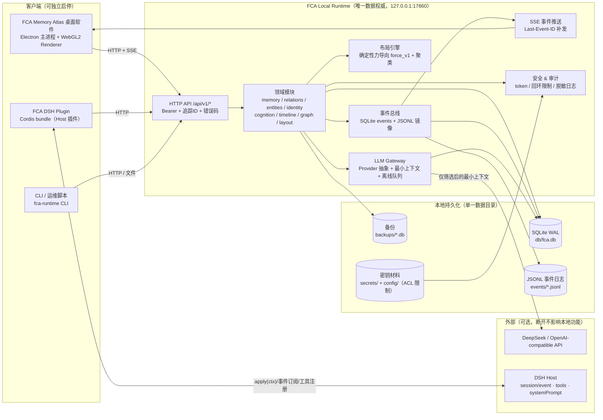

# FCA Memory Atlas — 架构设计（Alpha 0.1）

- 版本：0.1.0
- 状态：架构冻结（阶段 1）
- 相关：`docs/PUBLIC_INTERFACE_FREEZE.md`（数据/API 契约）、`docs/adr/`（技术决策记录）、`docs/ENVIRONMENT_REPORT.md`（阶段 0 实测环境）

## 1. 系统目标

FCA（Fish Cognitive Architecture）是独立于具体 LLM 的本地认知基础设施。Alpha 0.1 交付三个协作但边界清晰的产品：

1. **FCA Memory Atlas**：可安装的 Windows x64 桌面软件，提供星云式记忆可视化与完整编辑能力。
2. **FCA Local Runtime**：本地认知服务（默认 `127.0.0.1:17860`），唯一数据权威。
3. **FCA DSH Plugin**：正式 Cordis 插件，把 DSH Agent 的事件/检索/上下文与 Runtime 连接。

关闭任一 UI 不损坏数据；记忆读写不依赖 LLM；LLM 可替换。

## 2. 总体架构

## 3. 模块边界与职责

### 3.1 FCA Local Runtime（`runtime/`）

| 模块 | 职责 | 不做什么 |
|---|---|---|
| `src/server.js` | node:http 服务、路由、JSON 校验、错误码、追踪 ID、访问日志 | 不实现业务规则 |
| `src/persistence/` | node:sqlite 连接、迁移、事务、WAL、完整性检查、备份/恢复 | 不组装业务响应 |
| `src/memory/` | 记忆 CRUD、版本历史、diff、合并/拆分、软删/恢复、乐观并发 | 不渲染星图布局 |
| `src/relations/`、`src/entities/` | 关系/实体独立实体与版本 | 不级联删除记忆 |
| `src/events/` | 事件表、JSONL 镜像、SSE 广播、幂等、补发 | 不做业务决策 |
| `src/layout/` | force_v1 确定性布局、聚类、坐标持久化、命名视图 | 不改变记忆语义 |
| `src/graph/` | 把领域数据组装为渲染契约 §5 | 不伪造节点 |
| `src/identity/`、`src/cognition/` | 身份版本、认知模拟状态（明确标注非主观感受） | 不把模拟当意识证据 |
| `src/llm/` | Provider 抽象、上下文预算、加密密钥、离线队列 | 不传全库/全日志/全图 |
| `src/search/` | FTS5 全文（中文 bigram）、本地哈希向量语义检索（可选） | 不把语义检索做成基础读写依赖 |
| `src/security/` | token、回环限制、日志脱敏、审计 | — |
| `bin/fca-runtime.js` | CLI 入口（serve/init/backup/restore/export/import/seed/…） | — |

### 3.2 Desktop（`desktop/`）

- **main（主进程）**：窗口/菜单/单实例/日志/IPC/原生对话框/设置持久化/**Runtime 生命周期管理**（健康检查 → 必要时拉起 → 状态机；不误杀其它客户端在用的 Runtime）。
- **preload**：白名单 IPC 桥（contextIsolation=true，nodeIntegration=false）。
- **renderer（渲染进程）**：原生 ESM 模块化 UI，无构建步骤。`lib/api.js`（HTTP+SSE 客户端）、`lib/state.js`（响应式 store + undo/redo 命令栈）、`ui/`（基础组件）、`views/`（atlas/编辑器/时间线/搜索/列表/关系/数据/设置/向导）、`nebula/`（WebGL2 星云，独立模块，契约见 §5）。
- 桌面端不直接读写 SQLite；一切经 Runtime HTTP API。

### 3.3 FCA DSH Plugin（`dsh_plugin/`）

- **正式 Cordis bundle**：`package.json` 的 `dsh.bundle.patch` + `cordis.patch.yml` + Host 入口 `apply(ctx, config)`。
- 能力（以真实 SDK 为准，详见 `docs/DSH_PLUGIN_ENVIRONMENT_REPORT.md`）：
  - 订阅 `session/event`、`agent/inbox/inserted` 等把 DSH 事件按策略提交给 Runtime（幂等、排队、脱敏、失败重试）；
  - 通过 `ctx.tools.register` 向 Agent 暴露 `fca_memory_search/store/get`、`fca_status`；
  - 可选 `ctx.systemPrompt.context()` 注入最小相关记忆（默认关闭）；
  - 状态/连接/错误上报；插件异常隔离，不拖垮 DSH。
- 不复制记忆数据库；与桌面共用同一 Runtime 与同一数据。

## 4. 关键数据流

1. **手动创建记忆**：Desktop 编辑 → `POST /memory/store` → Runtime 事务写 memories + version + events(SQLite/JSONL) → SSE 广播 → Desktop 更新星图（增量或全量重同步）→ 布局引擎增量布局 → 新坐标持久化。
2. **Agent 写入**：DSH 事件 → Plugin `POST /event`（幂等）→ Runtime 按策略转换为记忆候选/审计事件 → SSE → Desktop 实时显示。
3. **检索**：Agent 工具调用 `fca_memory_search` → Runtime 本地检索（全文/语义/混合）→ 返回最小结果集（含来源、可信度、版本）。
4. **LLM 调用**：Runtime 先本地检索并筛选“最必要上下文”→ 经 Provider 调 API；API 断开 → 本地功能不降级，请求入队并标记未处理，恢复后重试；绝不伪装成功。
5. **布局分离**：拖动星体 → `POST /layout/nodes` 只写布局表；记忆正文/关系不变。
6. **备份/恢复**：`POST /backup`（VACUUM INTO + 校验）→ 恢复时校验 schema/完整性 → 原子替换 + 重启或热重载。

## 5. 进程与故障模型

- Runtime 是可独立运行的服务进程；桌面与插件均为客户端。谁先启动都可以按配置自动拉起 Runtime（单实例锁 + 健康检查），后启动的客户端直接复用。
- 任一 UI 退出：Runtime 默认可在无客户端时按 idle 策略退出（可配置为常驻）；退出前完成 WAL checkpoint，不丢已提交事务。
- 非回环地址默认拒绝；token 文件权限受限；日志脱敏（不记录正文、token、API Key）。
- 崩溃恢复：启动时检测 `-wal`/`-shm`、`PRAGMA integrity_check`；损坏时明确报错并指引从备份恢复，不静默重建。

## 6. 契约与版本

- 公共接口冻结于 `docs/PUBLIC_INTERFACE_FREEZE.md`：ID 规则、枚举、API、事件、错误码、渲染数据契约、目录结构、写入域。
- API 主版本 `/api/v1`；事件 `schema_version`；DB `PRAGMA user_version` + `schema_migrations`；迁移前自动备份。
- 插件与桌面启动时校验 `api_version === "1"`，不兼容时明确提示，不降级冒充成功。

## 7. 技术选型摘要（详见 ADR）

| 领域 | 选型 | ADR |
|---|---|---|
| Runtime 语言/存储 | Node 24 + 内置 `node:sqlite`，零第三方运行时依赖 | ADR-001 |
| 桌面封装 | Electron 38 + 原生 ESM renderer，无前端构建 | ADR-002 |
| 星云渲染 | WebGL2 数据驱动体积 raymarch + 实例化星体 + HDR 后处理 | ADR-003 |
| 数据架构 | SQLite 主存 + JSONL 事件镜像 + 独立布局表 + 可选向量索引 | ADR-004 |
| 进程模型 | 独立 Runtime 服务 + 客户端自动拉起 + SSE 同步 | ADR-005 |
| 安装分发 | electron-builder/NSIS 优先，IExpress 兜底；Node 运行时随包 | ADR-006 |
| LLM 与密钥 | Provider 抽象 + AES-256-GCM + ACL + 最小上下文 + 离线队列 | ADR-007 |
| DSH 集成 | 真实 Cordis bundle Host 插件（不修改 DSH） | ADR-008 |
| 安全模型 | 仅回环 + Bearer token + 审计 + 脱敏 | ADR-009 |
